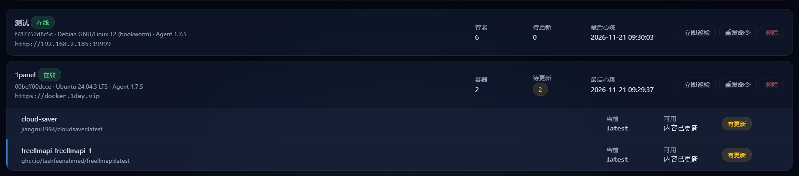
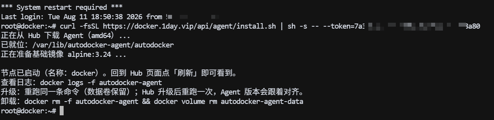
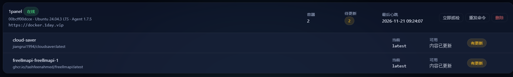

# AutoDocker

**Docker 镜像更新监测 · 飞书 / Telegram / 钉钉 / 企业微信确认 · 一键自动重建 · 多机统一监控**

[](https://github.com/haihaipypy/autodocker/releases/latest)
[](https://hub.docker.com/r/haihaipypy/autodocker)
[](LICENSE)
[](go.mod)

监测本机容器的镜像有没有新版本，推送到飞书、Telegram、钉钉或企业微信。在聊天里点「立即更新」，服务按原配置重建容器，
挂载、端口、网络、环境变量全部保留，失败自动回滚。没人用的镜像也能一键清理。


---

## 它解决什么问题

| 场景 | 传统做法 | AutoDocker |
| --- | --- | --- |
| 想知道镜像有没有更新 | 手动 `docker pull` 比对，或装个全自动更新的又不放心 | 定时巡检，发现更新推送到飞书 / Telegram / 钉钉 / 企业微信 |
| 决定要不要更新 | 登录 NAS / SSH 上去点 | 在聊天消息里点「立即更新」 |
| 更新容器 | 手写 `docker run`，容易漏掉挂载或环境变量 | 按原配置重建，字段零丢失 |
| 更新把服务搞挂了 | 手动找回原配置重新起 | 健康检查不通过自动回滚 |
| 磁盘被旧镜像占满 | 一个个 `docker rmi`，还怕删错正在用的 | 标明使用状态，一键清理未使用的 |
| 家里 NAS、云主机、VPS 各管一摊 | 每台装一套工具、各配一遍通知 | 一个页面管全部，通知只配一处；目标机装完即忘 |

## 特性

- **通知渠道可选**：飞书（企业自建应用，长连接收回调）、Telegram（bot 长轮询）、
  钉钉（企业内部应用，Stream 长连接 + 互动卡片）、企业微信（智能机器人，长连接 + 模板卡片）。
  填好凭据的渠道都会收到提醒，四个可以同时用。
  每个渠道有独立开关，关掉只停推送、配置保留。设置页左栏选渠道，右栏是所选渠道的完整配置流程。
- **推送接口**：本机其它程序（备份脚本、监控告警）带令牌调 `POST /api/push`，
  就能把消息推到已经配好的渠道，不用自己再配一遍机器人。消息不进通知历史。
- **容器与镜像分开管理**：容器页看「在跑的东西要不要更新」，镜像页看「磁盘上有什么、能不能清」。
- **可以管多台机器**：「节点」页添加远程服务器或 NAS，在目标机上跑一条命令即可 ——
  不开端口、不开 SSH，Agent 在后台跑着，装完即忘。巡检结果汇总到同一个页面，通知也只需配一处。
  同一局域网直接填内网地址；外网机器经 DDNS、隧道或组网穿透接入，详见
  [监控其他服务器 / NAS](#监控其他服务器--nas)。
- **两种检测模式自动判定**：浮动 tag 比摘要；版本号 tag 额外巡检 tag 列表，出现更高版本时提示。
- **按钮按状态渲染**，不摆灰按钮；检测失败的原因直接写在容器名下方。
- **两个忽略粒度**：卡片上「忽略本版本」只放行这一次远端内容，作者推了新版本照常提醒；
  容器页「忽略」是整条监控项不再检测。
- **深浅主题可切换**，默认深色。
- **聊天里点按钮后页面自动刷新结果**。
- **会检查自己有没有新版本**：每天看一眼，有就在顶栏提示「新版本」，点开能看到更新内容与升级步骤
  （飞牛包 / Docker 镜像两套，命令可一键复制）。只提示不自动升级，关掉开关就完全不联网。
  直连 GitHub 不通时自动换公共加速，不需要配置。

## 安装

三种方式任选。

### 1. 飞牛 fnOS 应用包

从 [Releases](https://github.com/haihaipypy/autodocker/releases/latest) 下载 `Autodocker.fpk`，
应用中心 → 手动安装 → 选中它。

装完桌面出现「Docker 更新助手」，也可直接访问 `http://<NAS_IP>:19999`。

→ [飞牛安装与排障](docs/install-fnos.md)：自己打包、ARM 机型、运行身份

### 2. Docker Compose（推荐）

在任意目录建一个 `docker-compose.yml`：

```yaml
services:
  autodocker:
    container_name: autodocker
    image: haihaipypy/autodocker:latest
    restart: unless-stopped
    ports:
      - "17777:17777"
    volumes:
      - /var/run/docker.sock:/var/run/docker.sock
      - ./data:/data
    environment:
      - TZ=Asia/Shanghai
      - PORT=17777
      - SELF_CONTAINER=autodocker
```

```bash
docker compose up -d
```

打开 `http://<IP>:17777`。需要飞书通知就进「设置」里填凭据。

仓库根目录的 `docker-compose.yml` 是同一份，带全部环境变量注释。

→ [Docker / Compose 部署与全部环境变量](docs/install-docker.md)

### 3. docker run

```bash
docker run -d --name autodocker --restart unless-stopped \
  -p 17777:17777 \
  -v /var/run/docker.sock:/var/run/docker.sock \
  -v "$PWD/data:/data" \
  -e TZ=Asia/Shanghai -e SELF_CONTAINER=autodocker \
  haihaipypy/autodocker:latest
```

要密码就加 `-e ADMIN_PASSWORD='你的密码'`。换端口要把宿主机端口和容器内 `PORT` 一起改，
比如 `-p 18000:18000 -e PORT=18000`。

Docker Hub 拉不动时换 GHCR：`ghcr.io/haihaipypy/autodocker:latest`，内容一致。

镜像为 `linux/amd64` / `linux/arm64` 双架构。升级：`docker compose pull && docker compose up -d`。

## 使用


定时巡检 → 发现新版本推送到飞书 / Telegram / 钉钉 / 企业微信 → 点「立即更新」→ 拉镜像、按原配置重建、健康检查
→ 通过则删旧容器，不通过自动回滚。

「可用」列写的是仓库里更高的版本号；没有更高版本号但同一 tag 被重新推送过，写「内容已更新」。

→ [完整使用说明](docs/usage.md)：两个列表的边界、忽略粒度、检测模式、清理策略

## 监控其他服务器 / NAS

除了本机，「节点」页可以把别的机器一起管起来。在目标机上跑一次命令，之后它上面的容器
就和本机的一样出现在页面里 —— 不开端口、不开 SSH、装完即忘。



**第一步：在 Hub 上添加节点**

「节点」→「添加节点」，填两样东西：

| 字段 | 说明 |
| --- | --- |
| 节点名称 | 随便起，用来区分，比如「群晖」「香港VPS」 |
| Hub 访问地址 | **必填**。目标机访问本服务用的地址：同一局域网填内网 IP，外网填 DDNS 域名、隧道地址或组网内网 IP |

地址框默认填的是你当前打开页面用的地址，可以直接用，也可以改。程序不替你猜能不能通 ——
在目标机上执行 `curl <这个地址>/api/health`，能返回 `{"status":"ok"}` 再往下走。

**第二步：在目标机上执行命令**

点「生成安装命令」，页面给出一条命令，复制到目标机上跑一次：

```bash
curl -fsSL http://192.168.2.10:17799/api/agent/install.sh | sh -s -- --token=xxxx
```

脚本只做三件事：检查 Docker 可用、从 Hub 取程序本体、启动一个后台容器。
不写 systemd unit、不改防火墙、不动宿主机的任何配置文件。



**第三步：回到页面**

「节点」页刷新，节点从「未连接」变「在线」，点一下展开就是它上面的容器和更新状态。



### 外网机器需要一个公网入口

目标机不在同一个局域网时，上面那个「Hub 访问地址」必须是**从目标机那一侧真能连到 Hub** 的地址。
三种做法都行，按推荐顺序排：

| 方式 | 怎么做 | 适合 |
| --- | --- | --- |
| **组网穿透**（推荐） | Tailscale、ZeroTier 之类把两台机器组进同一个虚拟网络，地址填对端在这个网络里的 IP | 不想把服务暴露到公网，家里 / 公司 / 云主机混着管 |
| **隧道** | Cloudflare Tunnel、frp、ngrok 把本地 17799 映射成一个 https 域名 | 有域名、想顺手拿到 HTTPS |
| **DDNS + 端口映射** | 有公网 IP（IPv4 或 IPv6）时在路由 / 光猫把 17799 放出去，用 DDNS 域名访问 | 有固定或半固定公网 IP |

前两种不把端口直接摊在公网上，优先考虑。用隧道时走 HTTPS（Cloudflare Tunnel 默认就是），
别用明文 http 传 Agent 令牌。

> **⚠️ 只要这个服务的端口离开内网，就必须先在「设置」里设好访问密码。**
> AutoDocker 挂着 `/var/run/docker.sock`，权限等同于宿主机的 root，页面上又有更新容器、清理镜像
> 这类真会动系统的操作。密码留空又暴露在公网，等于把整台机器交出去。
> 远程节点是同一套风险的另一面：目标机上的 Agent 同样能重建那台机器的容器，节点令牌也要当密码对待。

### 几条要知道的

- **地址填错** → 命令能装上，但 Agent 连不上，节点一直「未连接」。删掉重建一个即可。
- **重发命令**（换令牌）→ 节点立刻掉线，必须在目标机上重跑一次新命令，旧令牌当场失效。
- **升级** → 重跑那条 `curl | sh` 就是升级，脚本会替换容器并保留数据卷。
- **卸载** → `docker rm -f autodocker-agent && docker volume rm autodocker-agent-data`。
- **架构** → Hub 给目标机下发的是**与自己同一份**程序，所以要求两边架构相同（x86 对 x86、ARM 对 ARM）。
  架构不同时脚本会提示加 `--image` 改用镜像方式，此时目标机要能拉到 `haihaipypy/autodocker:<版本>`。
- **这一版只能看，不能远程更新** → 节点上的更新状态是真实的，但「点按钮重建」还没接上，
  远端更新放在下一版。所以远端节点暂时不推通知，免得点不了反而更烦。

Agent 是同一个镜像，靠 `AUTODOCKER_MODE=agent` 切角色：不监听端口、没有网页、不发通知，
只做巡检、上报、等指令。

→ [设计与取舍](docs/remote-nodes.md)：为什么不用 SSH、FN Connect 为什么走不通、协议与数据模型

## 通知配置

四个渠道任选其一或全用，都在「设置 → 通知渠道」里配。填好凭据的那个渠道测通后开关会自动打开；
关掉开关只停「推新提醒」，配置一项不动，已发出的卡片也照常回写状态。

### 飞书

**必须是企业自建应用。群自定义机器人（webhook）收不到按钮点击。**

六步：建应用 → 开机器人能力 → 申请 `im:message:send_as_bot`（应用身份）→
在「**回调配置**」标签页用长连接订阅 `card.action.trigger` → **发布新版本** →
把机器人拉进群，最后在设置页填 App ID / Secret / chat_id。

两个容易漏的点：回调加在旁边的「事件配置」里不生效；权限或回调改完不发布新版本，
点按钮报 `200340`，但卡片照收。

→ [飞书配置逐图步骤](docs/feishu.md)

### Telegram

五步：`@BotFather` 发 `/newbot` 拿 Token → 填进设置页**先保存一次** →
把 bot 拉进群并 **`@它` 说句话**（或直接私聊它发一条）→ 点「读取会话」，点一下会话即填入并保存 →
发送测试消息并**真的点一下**按钮。

三个容易漏的点：Token 不保存服务就不会开始长轮询，读不到会话 ID；
bot 默认读不到群里的普通聊天（成员列表写「无权读取消息」），得 `@它` 或关掉隐私模式；
这个 bot 若在别处设过 webhook 就收不到长轮询结果（两者互斥）。

> 国内直连 `api.telegram.org` 多半不通，「读不到会话」十有八九是这原因。
> 设置页有 **「检测连通性」**，不通时填**代理地址**（`192.168.1.2:7890` 或 `socks5://…`）或**API 地址**（自建反代）。

收到提醒时长这样，点按钮直接重建，不用回网页：


→ [Telegram 配置全流程](docs/telegram.md)

### 钉钉

**同样必须是企业内部应用。群机器人（webhook）只能单向推消息，收不到按钮点击。**

还要认清入口：后台「应用开发」下有个和「**钉钉应用**」并列的「机器人」，那是旧模型，
钉钉官方已说明「将逐渐退出历史舞台，不要用它来创建」。卡片模板关联、权限、版本发布
都在「钉钉应用」详情页里，从应用入口建才不用来回绕。

主线是六步：建企业内部应用 → 开机器人能力 → 在卡片平台搭一张模板并**发布**
（变量名用 `title` / `status` / `body`，按钮回传参数用 `{"action":"update"}` 这类 JSON）
→ 拿 `卡片模板 ID` 与 `Client ID / Secret` → 用 Stream 长连接订阅卡片回调 → 把机器人拉进群。

机器人那张配置表**除「消息接收模式」外全是必填**：名称、图标（建议 240×240）、
简介（≤10 字符）、描述（≤200 字符）、消息预览图（png/jpg，≤2M），最后模式选 **Stream**。
项目自带 `fnos/ICON_256.PNG` 可直接当图标。

三个容易漏的点：卡片**模板必须发布**，草稿态的模板没法投放；
按钮的回传参数是「一层 JSON 字符串」，写成裸 `update` 是取不到的；
机器人配置改完要去「版本管理与发布」发新版本，否则群里看到的还是旧信息。

钉钉卡片更新只改数据、不换整条消息，所以点完按钮后按钮会留在卡片上（飞书和 Telegram 是换掉整条）。

会话 ID **必须让机器人在群里收到过一次消息**才有（钉钉没有反查群列表的接口）。
记下来之后会存进数据库，重启、装新包都不用再 @，只有加新群才需要再来一次。

→ [钉钉配置逐图步骤](docs/dingtalk.md)

### 企业微信

**用「智能机器人 + 长连接」。** 卡片由程序生成，**不用去后台搭模板** —— 这是它比钉钉省事的地方。

六步：管理后台 **智能专区 → 智能机器人** 建机器人，创建方式选「API 模式创建」
→ 「API 配置」选**长连接** → 「可使用权限」授权**消息**与**通讯录**、使用方式选**多人使用**
→ 复制 `BotID` 与**长连接专用** `Secret` → 填进设置页保存
→ 群里 @ 机器人说句话，点「读取会话」挑一条。

群只有**企业内部群**能用，互联群 / 上下游群 / 外部群加不进去。

注意 `Secret` 有三个长得像的（长连接 Secret / Token / EncodingAESKey），只有第一个能用。

一个和别的渠道不同的限制：**卡片只能在点按钮后 5 秒内更新**，重建却要几十秒。
所以点「立即更新」后卡片会停在「正在更新」，结果改成**另发一条消息**告诉你。

→ [企业微信配置全流程](docs/wecom.md)

## 安全

- 挂载 `/var/run/docker.sock` 等同于宿主机 root 权限。
- **访问密码默认空即不启用登录。只要端口离开内网（公网 IP、DDNS、隧道、组网穿透都算），
  就必须先在「设置」里设好密码**，否则整个服务等于裸奔。
- 远程节点的令牌等同于那台机器的操作权限：只发给自己控制的机器；「重发命令」会让旧令牌立刻失效。
- 走公网时用 HTTPS，明文 http 会把令牌暴露在链路上。
- 服务会拒绝更新自身，也会拒绝更新带 `--rm` 的容器。

### 免责声明

本项目按「现状」提供，**未经任何第三方安全审计**，作者不承诺它没有漏洞。许可证中的免责条款
（[MIT License](LICENSE)，AS IS）同样适用。

它必须挂载 `/var/run/docker.sock` 才能工作 —— 这在事实上等同于把宿主机的 root 权限交给这个容器。
也就是说，只要服务本身存在任何一处问题（认证绕过、目录穿越、依赖库漏洞、反向代理配置失误、
弱密码），攻击者就能直接接管整台机器，读取上面的一切文件、密钥、数据库和业务数据，并以此为
跳板继续向内网扩散。这是本工具的工作原理决定的，不是配置问题。

因此：

- **不建议把本服务安装在任何存有重要资料、生产业务或他人数据的服务器上。** 想用就在测试机、
  闲置机，或者专门为它准备的机器上跑。
- **不要在没有密码的情况下把端口暴露到公网。** 公网 IP、DDNS、隧道、组网穿透，都算暴露。
- 是否使用、如何部署、暴露到什么范围，完全由你自行判断并承担后果。因使用或无法使用本软件
  造成的任何数据丢失、服务中断、信息泄露、财产损失及其他直接或间接后果，**作者不承担任何
  责任**，也不提供任何形式的明示或默示担保。
- 不能接受以上条件，请不要安装。

→ [安全须知与已知边界](docs/faq.md)

## 开发计划

已发布的版本见 [Releases](https://github.com/haihaipypy/autodocker/releases)。

| 版本 | 状态 | 内容 |
| --- | --- | --- |
| 1.7.x | ✅ 已发布 | 远程节点：一条命令接入、容器快照上报、在线状态、手动巡检 |
| 1.8.0 | 🚧 开发中 | 远程一键更新：节点上的容器可直接重建，进度实时回传，通知卡片按节点路由，任务记录区分本机与节点 |
| 1.9.0 | 📋 计划 | 批量更新、节点批量升级、Agent 版本落后提示、节点离线告警 |
| 更远 | 💭 待定 | x86 的 Hub 直接下发 ARM 二进制（不必退回镜像）、节点分组、按节点单独设巡检间隔 |

原则是宁可少做一步也不留半截：v1.7 只做「看得见」，是因为「点得动」需要进度回传配合，
否则点下去几十秒没反应，比不能点更糟。

## 技术简述

- 纯 Go 单二进制，前端零构建（`go:embed`），SQLite 用 `modernc.org/sqlite`（免 CGO）。
- 不依赖 Docker 官方 SDK，直接封装 Engine REST API，`HostConfig` 原样透传。
- 四个渠道全是长连接：飞书走 WebSocket、Telegram 走 bot 长轮询、
  钉钉走 Stream、企业微信走官方长连接 —— 都免公网、免备案、免反向代理。
- 注册表加速三层兜底：用户设置 → 守护进程 `registry-mirrors` → 内置默认，只作用于 Docker Hub。

→ [技术实现与目录结构](docs/architecture.md)

## 许可与致谢

MIT，见 [LICENSE](LICENSE)。

本项目为独立实现，`go.mod` 只依赖飞书 SDK 与纯 Go SQLite 驱动，业务代码全部自研。
[vigil](https://github.com/jingyuan9527/vigil) 与
[dockerCopilot](https://github.com/onlyLTY/dockerCopilot)（均 AGPL-3.0）仅作思路参考，未复制其代码。

## 文档索引

| 文档 | 内容 |
| --- | --- |
| [install-fnos.md](docs/install-fnos.md) | 飞牛应用打包、安装、运行身份、排障 |
| [install-docker.md](docs/install-docker.md) | Docker / Compose 部署、全部环境变量、本地开发 |
| [feishu.md](docs/feishu.md) | 飞书自建应用配置全流程（含截图） |
| [telegram.md](docs/telegram.md) | Telegram bot 配置全流程、收不到消息的排查 |
| [dingtalk.md](docs/dingtalk.md) | 钉钉企业内部应用、卡片模板、Stream 长连接的配置全流程 |
| [wecom.md](docs/wecom.md) | 企业微信智能机器人、长连接、按钮与 5 秒限制 |
| [usage.md](docs/usage.md) | 两个列表的边界、忽略粒度、检测模式、界面 |
| [remote-nodes.md](docs/remote-nodes.md) | 多节点监控：架构取舍、安装流程、协议、数据模型、FN Connect 结论 |
| [architecture.md](docs/architecture.md) | 技术选型、重建保真规则、存储坑位、测试 |
| [faq.md](docs/faq.md) | 安全须知、已知边界、常见故障排查 |
| [release.md](docs/release.md) | 版本号、CI、Docker Hub / GHCR、Release 上传 |

---

作者：**无辣** · [blog.1day.vip](https://blog.1day.vip)
