# 钉钉配置

> 返回 [README](../README.md) · 其他渠道：[飞书](feishu.md) / [Telegram](telegram.md)

配好之后，发现镜像有新版本会往钉钉群推一张卡片，**点卡片上的按钮直接重建容器**，手机上也能操作。

**必须创建应用 + 内部机器人，群自定义机器人（webhook）不行** —— 它只能单向发消息，收不到按钮点击。
按钮点击走 **Stream 长连接**，所以全程不需要公网 IP、不用域名、不用备案、不用内网穿透。

配置需要**企业管理员**账号。

整条流程六步，外加搭一张卡片模板：

| 步骤 | 在哪做 | 拿到什么 |
|---|---|---|
| 1 建应用 | 钉钉开放平台 → 钉钉应用 | Client ID / Client Secret |
| 2 加机器人 | 应用内 → 应用能力 → 机器人 | 群里那个机器人 |
| 3 开权限 | 应用内 → 权限管理 | 发卡片、发消息的授权 |
| 4 建模板 | 卡片平台 | 卡片模板 ID |
| 5 发布版本 | 应用内 → 版本管理与发布 | 让前四步生效 |
| 6 拉群取会话 | 钉钉群 + AutoDocker 设置页 | 群会话 ID |

---

## 一、钉钉配置流程

### 1. 新建应用

打开 [钉钉开放平台](https://open-dev.dingtalk.com/)，走「应用开发 → 钉钉应用」→ 创建应用。
建好后在「凭证与基础信息」里复制 `Client ID` 与 `Client Secret`。

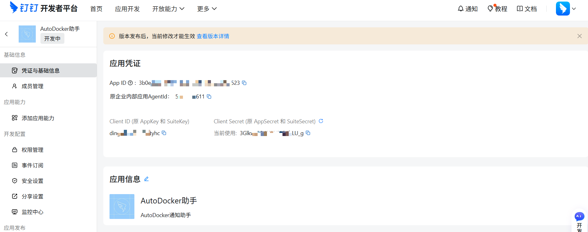

把这两个值填进 AutoDocker 左侧面板，点右边的「检测连通性」验一下，通了会自动保存并拉起长连接。

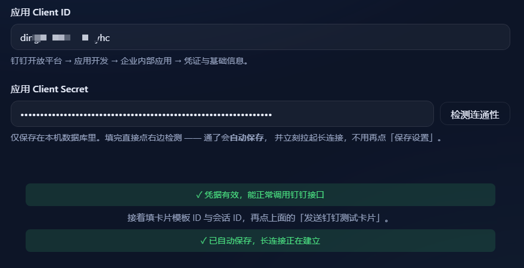

> 左侧还有一个与「钉钉应用」**并列**的「机器人」入口，那个是旧模型，钉钉官方已说明
> 「将逐渐退出历史舞台，不要用它来创建」。本流程需要的卡片模板关联、权限、版本发布
> 都在「钉钉应用」详情页里，从应用入口建才能一条路走完。

### 2. 添加机器人

在刚建好的应用里，左侧「应用能力」→ 机器人 → 机器人配置。

| 配置项 | 必填 | 限制 | 填写内容 |
|---|---|---|---|
| 机器人名称 | 是 | — | `AutoDocker` |
| 机器人图标 | 是 | 建议 240×240 方形 | 见下图 |
| 机器人简介 | 是 | **最多 10 字符** | `镜像更新提醒`（6 字符，留足余量） |
| 机器人描述 | 是 | **最多 200 字符** | `发现 Docker 镜像有新版本时推送一张卡片，点卡片上的按钮即可按原配置重建容器，失败自动回滚。` |
| 机器人消息预览图 | 是 | png/jpg，**≤2M** | 见下图 |
| 消息接收模式 | 否 | HTTP / Stream | **Stream** |

图标和消息预览图用下面这两张（也可以直接用仓库里的
[`fnos/ICON_256.PNG`](../fnos/ICON_256.PNG) 和 [`docs/images/ui-dark.png`](images/ui-dark.png)）：


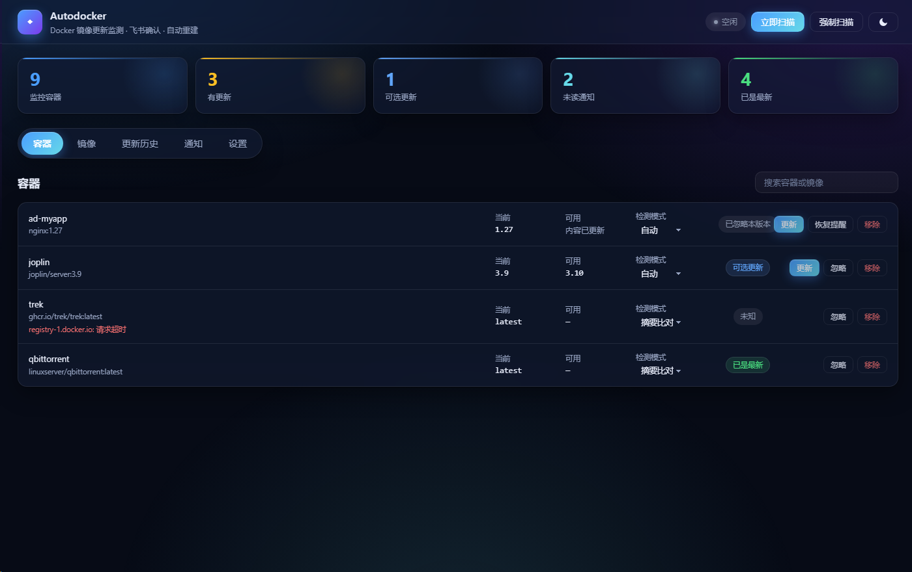

填完大概是这样：

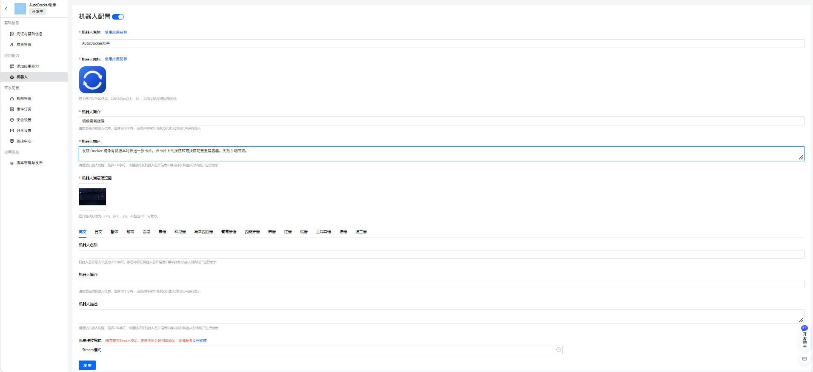

> **简介和描述会出现在群成员点「添加机器人」时的列表里**，写成「机器人1号」那种，
> 别人不知道是干什么的、也就不会去加。预览图是群内加机器人时的示意，不是卡片本身的样子。
>
> 选成 HTTP 模式后，钉钉会要求填一个公网回调地址，填不出来整条链路就不通。

### 3. 开权限

左侧「权限管理」，搜到下面两项并开通：

| 权限点 | 作用 | 缺了会怎样 |
|---|---|---|
| `Card.Instance.Write`（互动卡片实例写权限） | 投放卡片、更新卡片 | 卡片发不出去，报权限错误 |
| `qyapi_robot_sendmsg`（企业内机器人发送消息） | 机器人往群里发消息 | 发送报权限错误 |

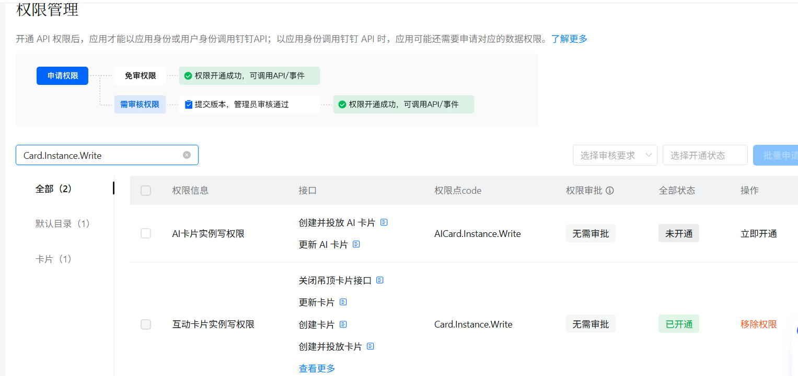

> `Card.Streaming.Write` 是 AI 卡片流式更新用的，这里不需要，别多开。

### 4. 建卡片模板

打开 [卡片平台](https://open-dev.dingtalk.com/fe/card)，新建模板。按下个章节
[模板怎么搭](#二模板怎么搭)拖好组件、发布，然后复制模板 ID（形如 `xxxx-xxxx.schema`）填到左边。

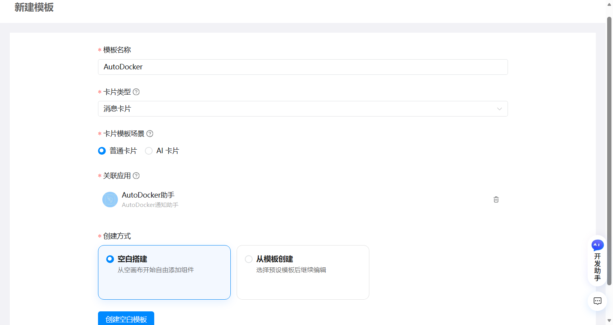

### 5. 发布应用版本

左侧「版本管理与发布」→ 创建版本 → 发布。

**改了权限、机器人或模板却不发布新版本，等于什么都没改。** 现象是配置看着全对，
发卡片一直报权限或模板错误。

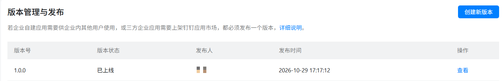

### 6. 拉群并取会话 ID

钉钉群里 → 群设置 → 智能群助手 → 添加机器人，选你刚建的那个。

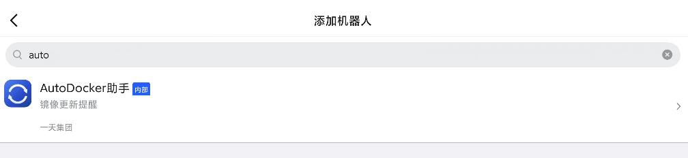

然后在群里 **@它说一句话**。

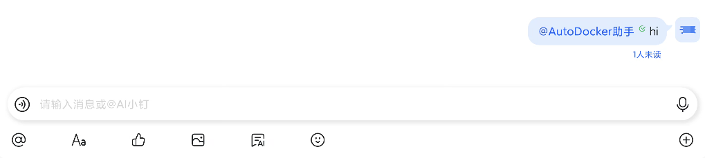

回来点左边「读取会话」，列表里会冒出这个群，点一下即自动填入并保存。

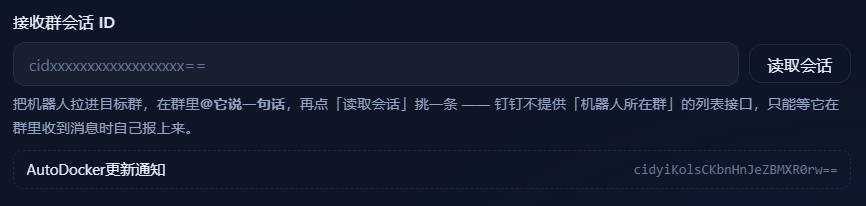

> 会话 ID 只能靠「机器人在群里收到过一条消息」带上来 —— 钉钉没有反查群列表的接口。
> 这条记录会存进数据库，**服务重启、装包升级都不会丢**，只有加了一个新群才需要再 @ 一次。

**点「读取会话」是空的，按顺序查这三条**：

1. **再 @ 一次。** 如果这条会话从来没被记下来过，列表就是空的。两种情形最典型：
   先 @ 后装包；@ 的那会儿长连接还没连上（顶栏显示「未连接」，鼠标停上去能看到原因）。
2. 应用 → 应用能力 → 机器人 → 编辑，**消息接收模式是不是 Stream**。选成 HTTP 时
   钉钉把 @ 消息推到你没填的公网地址，Stream 一条也收不到。
3. 群里 @ 的是不是**这个**机器人 —— 智能群助手里可能有多个同名的，必须是「企业内部机器人」
   里你建的那个；另外企业机器人只在**企业内部群**收消息，跨企业的普通群收不到。

日志里收到消息会打一行 `钉钉机器人收到消息，已记录会话 conversation_id=…`。
有这行说明后端收到了、是网页没刷新；没这行就是钉钉没推过来，回到第 2 条。

---

## 二、模板怎么搭

钉钉不允许用代码定义卡片样式，只能自己在平台上搭模板、设变量。操作不复杂，
但参数一个都不能错，写错了卡片发出去就是一片空白。

### 1. 新建三个变量

| 变量名 | 变量类型 |
|---|---|
| `title` | 普通文本 |
| `status` | 普通文本 |
| `body` | **富文本** |

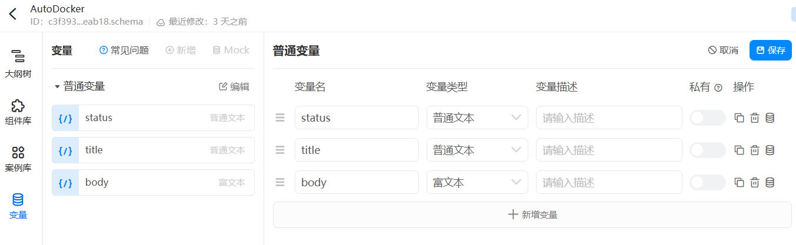

变量面板在左侧竖排最下面那个「变量」图标上（`大纲树 / 组件库 / 案例库` 下面第四个，
图标像一张表格）。名字**必须一字不差**是这三个小写单词。

### 2. 添加组件

从组件库拖 **2 个基础文本** + **1 个富文本** + **3 个单个按钮** 到卡片里。

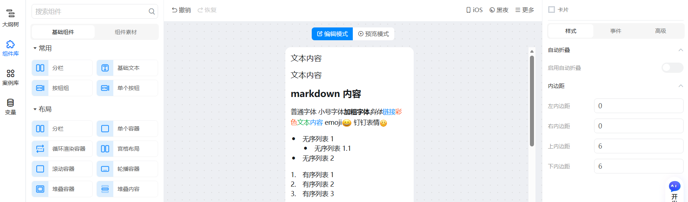

> 正文别用基础文本：程序传给 `body` 的内容是 Markdown（`**容器**：xxx` 这种），
> 基础文本会把星号原样显示出来。

### 3. 绑定变量

三个组件的**内容**分别指向 `title` / `status` / `body`。
在输入框里敲一个 `$` 就会弹出变量列表，点一下就插进去了。

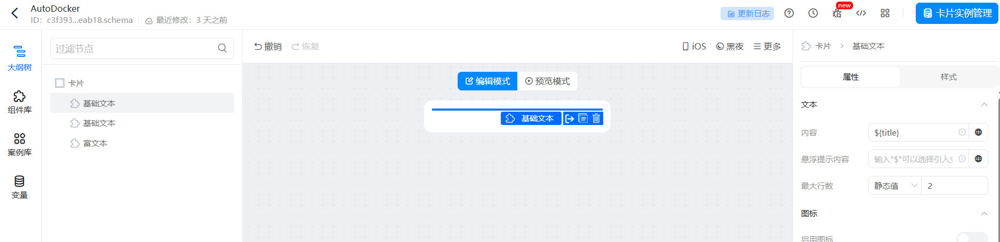

> 原来的示例文字 `文本内容` 要**先删干净再插变量**，否则会变成 `文本内容${title}`，
> 发出去前面多出那四个字。
>
> 此时还没有实际数据，画布上看不到东西是正常的。

### 4. 添加按钮

三个**单个按钮**组件，文案分别填 `立即更新`、`稍后提醒`、`忽略本版本`。
每个按钮都去「事件」里设「回传请求」，参数如下：

| 按钮文字 | 回传参数 | 作用 |
|---|---|---|
| 立即更新 | `{"action":"update"}` | 触发重建 |
| 稍后提醒 | `{"action":"snooze"}` | 本轮跳过 |
| 忽略本版本 | `{"action":"ignore"}` | 不再提醒这一版 |

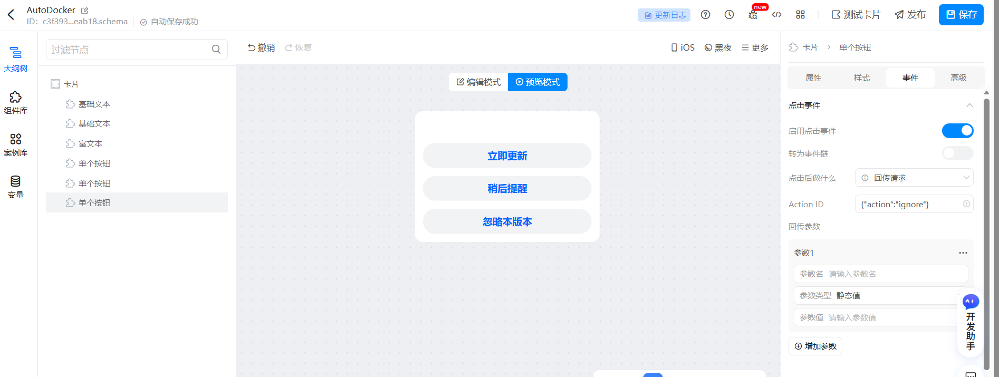

对美观度有要求就自己调样式，只要参数没错就行，改完**保存模板**。

> 按钮的「组件唯一 ID」由平台自动生成，本应用不依赖它 —— 只认 `action`。
> 所以以后重排版、换按钮顺序都不用改代码。
>
> 回传参数写成 `{"action":"update"}` 或直接写裸的 `update` 都认；写成别的就点不动。

**模板必须发布**，草稿态的模板没法投放，发消息会报 `param.templateUnpublished`。
发布不可逆，发布后要改只能复制一份重来 —— 所以先点右上角「测试卡片」看好效果再发布。

---

## 三、测试回调

### 1. 发一张测试卡片

点「发送钉钉测试卡片」，页面会挂起等待回调。

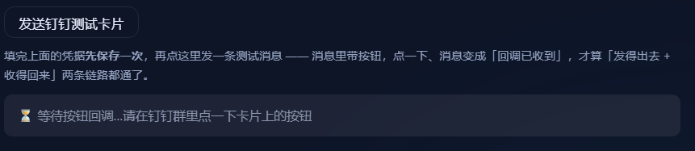

### 2. 群里点一下按钮

钉钉群会收到一张测试卡片。这张卡片用的是同一个模板，**点上面任意一个按钮都算验证通过**。

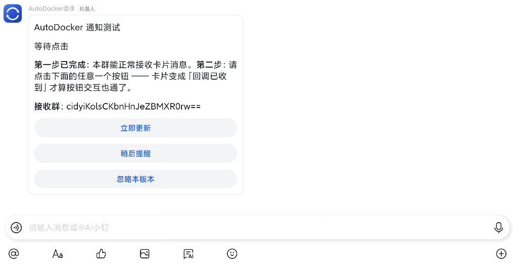

### 3. 看到回调结果

卡片原地变成「回调已收到」，说明按钮点得动、服务端也收得到。

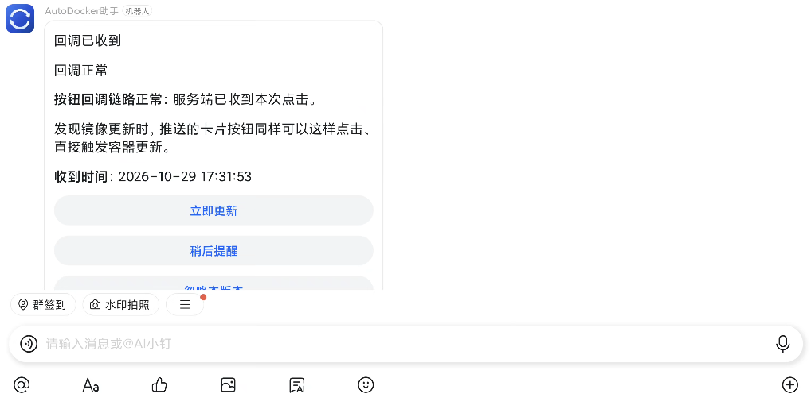

应用页面同时提示按钮链路正常：

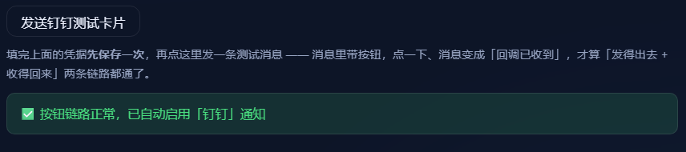

这一版加了通知开关，链路一通就自动打开。

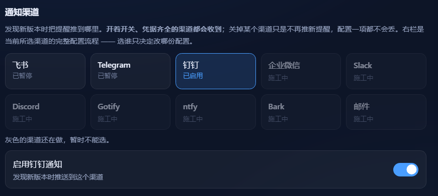

**点按钮没反应时按顺序查**：先点「检测连通性」，它只验凭据和出网，一次能把这两件事
说清；连通之后还收不到卡片，再看模板有没有发布、按钮的回传参数有没有配对。
卡片收到了但点了没变化，多半是第五步的版本没发布。

---

## 四、日常使用

### 1. 收到新版提醒

巡检发现有镜像更新，钉钉群里会收到卡片，容器、镜像、当前版本、可用版本都列在上面。

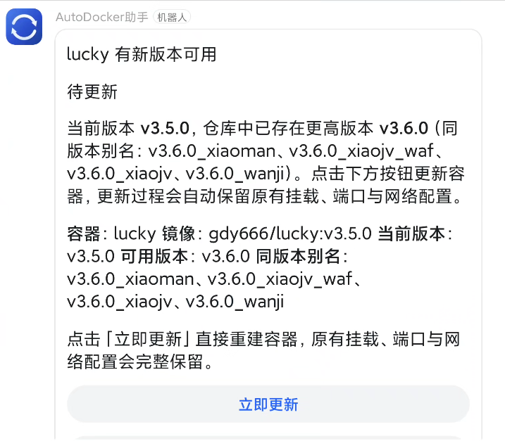

### 2. 点「立即更新」

NAS 收到指令开始拉镜像、重建容器，卡片原地变成进度。

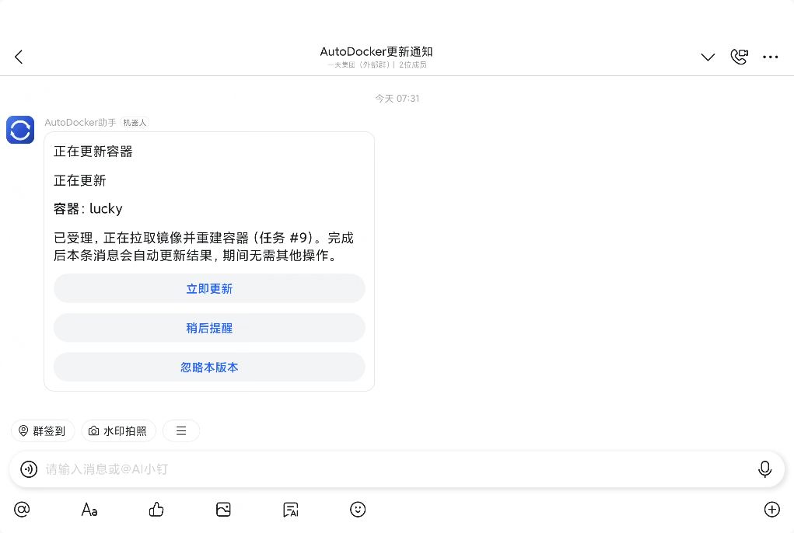

### 3. 卡片自动更新结果

拉完、重建完，状态回到同一张卡片上，不用回网页、不用登服务器。

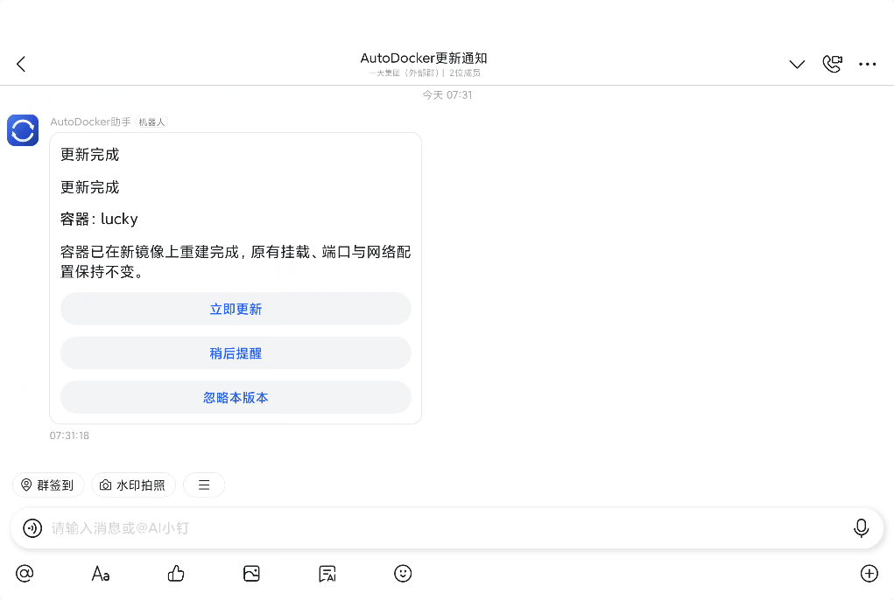

> 钉钉只改数据不改结构，所以「更新完成」之后按钮仍留在卡片上（飞书和 Telegram 是换掉整条）。
> 再点会提示「更新已在进行中」，不会重复执行。

---

## 五、常见报错对照

| 现象 | 原因 |
|---|---|
| `authFailed` / `invalidClientIdOrSecret` | Client ID 或 Secret 抄错 |
| `Forbidden.AccessDenied` / 权限不足 | 权限没开，或开了但没发布新版本 |
| `param.templateUnpublished` | 卡片模板没发布 |
| `param.cardTemplateIdEmpty` / 模板不存在 | 填的是模板**名称**不是 ID，或模板属于别的应用 |
| 卡片发出去了但点了没反应 | 见下一节；多半是按钮没配「回传请求」，或参数不是 `{"action":"..."}` |
| 卡片发不进群 | 机器人没加进这个群，或群会话 ID 是别的群的 |
| 报「机器人对该用户无可用范围」 | 应用发布时可用范围没包含这个群的成员 |
| 长连接一直连不上 | 这台机器访问不了 `api.dingtalk.com`，或凭据错误（看设置页的报错原文） |

## 六、点了按钮没反应，去日志里看

服务日志只有一个文件。卷号 N 视安装位置而定，不确定就先定位：

```bash
ls -d /vol*/@appdata/Autodocker          # 看装在第几卷
tail -f /vol1/@appdata/Autodocker/autodocker.log
```

点一次按钮，对照新冒出来的那几行：

| 日志里出现 | 含义 | 接着查什么 |
|---|---|---|
| `收到钉钉卡片回调` | 回调确实进来了（后面还带 action 与 content 原文） | 看 action 是不是空 |
| 后面跟 `钉钉卡片回调里没有可识别的通知 ID` | 卡片 ID 里解不出通知 | 这张卡不是本服务发的 |
| 后面跟 `钉钉卡片回调与投递记录不匹配` | 找到通知了，但这张卡不是它发出去的 | 同上 |
| 后面跟 `钉钉卡片回调未改变任何状态` | action 不认识（不是 update / snooze / ignore） | 回模板检查回传参数 |
| 后面跟 `开始执行更新 task=…` | 通了，任务已经在跑 | 卡片几秒内会变 |
| **一行都没有** | 回调根本没进来 | 按钮事件不是「回传请求」，或改完没发布 |

`收到钉钉卡片回调` 这行会把 `content` 原文一起打出来。**实战中它长这样**（`params` 是空的，
回传参数的原文躺在 `actionIds` 里）：

```
收到钉钉卡片回调 out_track_id=ad-11-1793489478237822724-1 action=update
  content={"cardPrivateData":{"actionIds":["{\"action\":\"update\"}"],"params":{}}}
```

`action=` 后面是空的，说明模板里的回传参数没配对。三个按钮分别对应
`update` / `snooze` / `ignore`，写错一个不影响另外两个。
