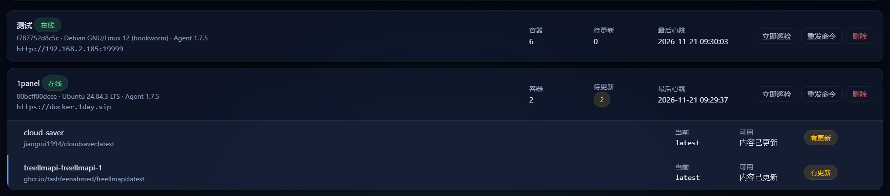
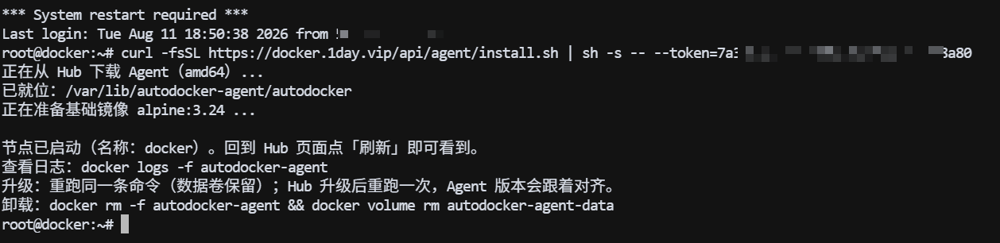
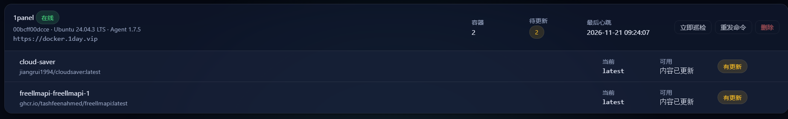

# 节点使用手册

「节点」页用来管本机以外的服务器 / NAS。目标机上跑一条命令，它上面的容器就和本机的一样
出现在页面里：有更新会推提醒，卡片上点一下就在**那台机器上**按原配置重建。

不开端口、不开 SSH、目标机上没有网页也没有配置文件，装完即忘。



---

## 一、添加节点

「节点」→「添加节点」，填两样东西：

| 字段 | 说明 |
| --- | --- |
| 节点名称 | 随便起，用来区分，比如「群晖」「香港VPS」 |
| Hub 访问地址 | **必填**。目标机访问本服务用的地址：同一局域网填内网 IP，外网填 DDNS 域名、隧道地址或组网内网 IP |

地址框默认填的是你当前打开页面用的地址，可以直接用，也可以改。程序不替你猜能不能通 ——
在目标机上执行 `curl <这个地址>/api/health`，能返回 `{"status":"ok"}` 再往下走。

点「生成安装命令」，页面给出一条命令，复制到目标机上跑一次：

```bash
curl -fsSL http://192.168.2.10:17799/api/agent/install.sh | sh -s -- --token=xxxx
```

脚本只做三件事：检查 Docker 可用、从 Hub 取程序本体、启动一个后台容器。
不写 systemd unit、不改防火墙、不动宿主机的任何配置文件。



回到页面刷新，节点从「未连接」变「在线」，点一下展开就是它上面的容器和更新状态。



### 外网机器需要一个公网入口

目标机不在同一个局域网时，「Hub 访问地址」必须是**从目标机那一侧真能连到 Hub** 的地址。
三种做法都行，按推荐顺序排：

| 方式 | 怎么做 | 适合 |
| --- | --- | --- |
| **组网穿透**（推荐） | Tailscale、ZeroTier 之类把两台机器组进同一个虚拟网络，地址填对端在这个网络里的 IP | 不想把服务暴露到公网，家里 / 公司 / 云主机混着管 |
| **隧道** | Cloudflare Tunnel、frp、ngrok 把本地 17799 映射成一个 https 域名 | 有域名、想顺手拿到 HTTPS |
| **DDNS + 端口映射** | 有公网 IP（IPv4 或 IPv6）时在路由 / 光猫把 17799 放出去，用 DDNS 域名访问 | 有固定或半固定公网 IP |

前两种不把端口直接摊在公网上，优先考虑。用隧道时走 HTTPS（Cloudflare Tunnel 默认就是），
别用明文 http 传 Agent 令牌。

> **⚠️ 只要这个服务的端口离开内网，就必须先在「设置」里设好访问密码。**
> AutoDocker 挂着 `/var/run/docker.sock`，权限等同于宿主机的 root。密码留空又暴露在公网，
> 等于把整台机器交出去。远程节点是同一套风险的另一面：目标机上的 Agent 同样能重建那台
> 机器的容器，节点令牌也要当密码对待。

### 用反代时

反向代理要支持 WebSocket（升级头 `Upgrade` / `Connection`）。Cloudflare Tunnel 默认支持，
Caddy 自动处理，Nginx 需要手写：

```nginx
proxy_http_version 1.1;
proxy_set_header Upgrade $http_upgrade;
proxy_set_header Connection "upgrade";
proxy_read_timeout 3600s;
```

Agent 连不上时日志里会提示这一点。

---

## 二、远程更新

展开节点后，**确实有更新的容器行右侧会出现「更新」按钮**，点一下就在那台机器上按原配置重建 ——
和本机的「立即更新」是同一套逻辑：拉新镜像 → 停旧容器 → 原配置建新的 → 健康检查 → 失败回滚。

点下去后卡片上会出现一条横幅，实时显示进度（拉取镜像 / 停止旧容器 / 创建新容器 / 健康检查），
几十秒到几分钟不等。结束时会显示「更新完成」或「更新失败 + 原因」，随后容器的状态列也跟着刷新。

几条边界：

- **一次只更新一台机器上的一个容器**。上一台没跑完时，别的节点照常能点，同一台会被拒。
- **只给确实有更新的行按钮**。已是最新、检测失败、已忽略的都没有，点了也只会得到「没有可用的更新」。
- **更新期间别重启 Agent**。重建过程是在 Agent 里跑的，中途杀进程可能留下半截状态。
  网络抖动、WS 断线都不要紧，更新会继续跑完。
- **远端发现更新也会推提醒**，标题带节点名（`1panel · cloud-saver 有新版本可用`），
  卡片上的「更新」按钮直接在那台机器上重建，结果会写回同一条消息。同一个版本只提醒一次，
  点「稍后」的话下一轮巡检会重新提。

### 按 compose 项目批量更新

**同一个 compose 项目的多个服务合成一条提醒**：`1panel · safeline（6 个容器）有新版本可用`，
正文列出每个服务。点一次「立即更新」按顺序逐个重建，一次只动一个，失败即停并写明停在哪一个；
重试时已经成功的不会再跑一遍。容器所属项目取自 compose 标签，用 `docker run` 建的容器没有这个标签，
仍然是一条一个。

**节点页的容器列表也按项目合并**：`safeline · 7 个容器` 一行、一个「更新」按钮，
点一次依次重建整个项目，按钮上显示进度（`更新中 3/7`）；失败停在哪一个就把原因写在那一行下面。

批量更新有两层保护：

- **先把镜像拉齐，再动容器**：点一次之后整批镜像先全部拉到本地，任何一个拉不到
  就整批停在原地 —— 容器一个都没有被重建，不会留下「一半新版一半旧版」的 compose 项目。
  镜像都到位后才开始逐个重建，停机窗口只在这第二阶段出现。
- **按 `depends_on` 排重建顺序**：一个项目里写了依赖的容器，先换数据库、再换中间层、
  最后换反代，下游重建时上游已经是新版并且在跑。没写 `depends_on` 的项目、用 `docker run`
  建的容器保持原来的顺序。节点的 Agent 需要 1.11.0 及以上才会上报依赖，老 Agent 按原顺序走，不报错。

### compose 项目里的版本会跟着改

重建之前，程序会把这个服务在 compose 文件（或它读的 `.env`）里的 tag 改成新版本，
原文件先备份成 `xxx.autodocker.bak`；更新失败并回滚时会把文件改回去。

这样下次有人跑 `docker compose up -d`，不会把容器退回旧版本。

改之前会核对文件与容器是否一致（容器当前跑的引用必须与文件里解析出来的一致）、仓库名是否对得上，
对不上就只换容器、一个字都不改文件，任务日志里会留一行提示。文件不在本机能读到的位置、
`.env` 缺失、用 digest 固定版本这类情况同样只提示，不影响更新本身。

### 没反应或失败时

- **提醒卡在「正在更新」不动**：到网页「通知」页，给那一条点「重试更新」。
  那边会先确认节点是不是真在跑，还在跑就什么都不做，已经结束就重新下发一遍。
- **失败的那一条会写明原因**：网页「通知」页的红字就是节点返回的报错，
  右侧有「重试更新」，原地点一次重来，成功后红字自动消失。
- **「更新历史」里能看出是哪台机器**：远端任务带节点标签，本机任务不带。

---

## 三、节点离线通知

「设置 → 远程节点 → 节点失联时推送一条消息」默认开启，可以设判定时间（默认 10 分钟，最短 2 分钟），
推到已配好的通知渠道。

判定分两层：连接断开 90 秒（三次心跳没有回应）就在页面上标「离线」；超过设定时间才发消息。
下面几种不会报：

- Hub 刚启动的 3 分钟内 —— 那会儿所有节点都在重连。
- 这次运行里从没连上过的节点（刚添加、Agent 还没装好）。
- Agent 自动升级造成的断线：正常几十秒就回来，够不到阈值。

同一次失联只发一条，节点回来时补一条「已恢复」。**全部节点同时失联只发一条汇总**，
那种情况多半是本机网络或出口断了，不是每台机器各自坏了。

---

## 四、节点用同一个加速源

「设置 → 远程节点 → 把镜像加速地址下发给所有节点」默认开启。保存设置时，Hub 把
「注册表加速」那一格里的地址推给所有在线节点，节点下一次巡检就用新的源，不用重启 Agent；
节点重连时也会从握手回执里拿到同一份。

- 节点侧要 1.12.0 及以上才认这条指令，没升级的会静默跳过，卡片上不会报错。
- 那一格**留空**时，节点回到它自己的配置（不是被清空成直连）。
- 关掉开关就不再下发，节点保持当前在用的那份。
- 节点页某一行写「所有镜像源均失败」时，先看这一格是不是填了对该镜像不友好的源 ——
  节点的检测是 Agent 自己发请求，不走 Docker 守护进程，那台机器 `daemon.json` 里的
  `registry-mirrors` 帮不上忙。

---

## 五、Agent 自动升级

Hub 升级到新版本后，节点下次连上来时会自己换成同一版：**不用再登录目标机重跑安装命令**。

Agent 先从 Hub 把新版本取下来，拉起一个一次性的 helper 容器，由它停掉旧容器、
按原来的挂载 / 环境变量 / 重启策略建一个同样的新容器、观察几秒确认它站得住，然后把旧的删掉。
任何一步失败都会把旧容器和旧二进制原样放回去 —— 节点最多离线十几秒，回来还是原来那版。

- 开关在「设置 → 远程节点」：**节点 Agent 自动跟随 Hub 升级**，默认开启。
- 关掉之后只剩手动：节点卡片上的 **「升级 Agent」** 按钮（版本落后时才出现）。
- 同一个版本连试两次都失败就不再自动重试，卡片上会写着上次失败的原因，处理完可以手动点一次。
- **1.9.0 之前装的 Agent 不认识升级指令**，需要在目标机上重跑一次安装命令；
  升到这一版之后就不用再手工介入了。卡片上会有明确提示，不会静默失败。

---

## 六、删除与卸载

点「删除」不会立刻删 —— 先弹一个确认窗，列出这台机器的状态、系统、Agent 版本、心跳时间
和那条卸载命令（可一键复制），确认后才删 Hub 侧记录。

**目标机上的 Agent 不会因此卸载。** 要彻底清掉，拿着那条命令去那台机器上执行：

```bash
docker rm -f autodocker-agent && docker volume rm autodocker-agent-data
```

---

## 七、几条要留意的

- **地址填错** → 命令能装上，但 Agent 连不上，节点一直「未连接」。删掉重建一个即可。
- **重发命令**（换令牌）→ 节点立刻掉线，必须在目标机上重跑一次新命令，旧令牌当场失效。
- **架构** → Hub 给目标机下发的是**与自己同一份**程序，所以要求两边架构相同（x86 对 x86、
  ARM 对 ARM）。架构不同时脚本会提示加 `--image` 改用镜像方式，此时目标机要能拉到
  `haihaipypy/autodocker:<版本>`。
- **目标机上要能拉到 `alpine:3.24`**（约 3 MB）。程序本体由 Hub 直接给，不经过 Docker Hub。

---

→ [实现细节与设计取舍](remote-nodes.md)：为什么不用 SSH、通信协议、数据模型、FN Connect 为什么走不通
